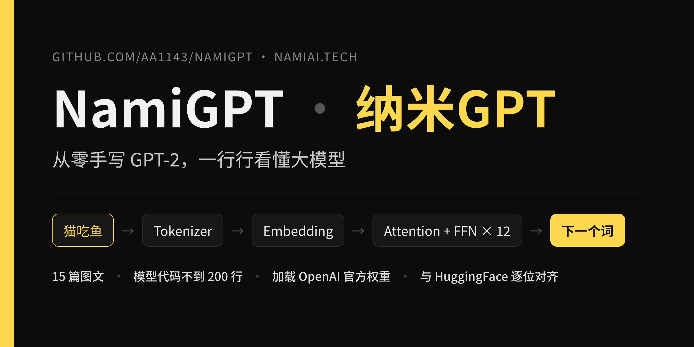

<p align="center"></p>

# NamiGPT

**零基础入门大模型（LLM）的基础教程：从零手写 GPT-2，一行行看懂大模型是怎么工作的。**

[](https://github.com/aa1143/NamiGPT/actions/workflows/test.yml)

不需要任何大模型基础，只要会一点 Python。我们用 PyTorch 从零手写一个 GPT-2，加载 OpenAI 官方权重，跑通推理和文本生成。

- 不调用任何现成的 Transformer 模块，模型代码 [`gpt2/model.py`](gpt2/model.py) 不到 200 行
- 用一个 3 个词的例子「猫吃鱼」，从分词一路推到文本生成，每篇都配可运行脚本
- 和 HuggingFace 官方实现逐项对齐，[测试](tests/test_vs_huggingface.py)保证结果一致

## 写在前面

这个系列是我自己从零开始、一点一点学大模型留下的笔记。

一开始我也看不懂 Attention 公式里的 Q、K、V，不知道 768 维的向量到底在算什么。所以我给自己定了一个笨办法：每学一个模块，就用最小的例子「猫吃鱼」把矩阵一步步算出来，再亲手写成代码跑一遍，确认真的懂了，才往下走。

15 篇文章，就是这条路上的 15 个台阶。从分词、Embedding、注意力，一直写到加载 OpenAI 的官方权重、让模型真正生成文字。仓库里的每一行代码，我都自己写过、跑过。

如果你也想搞懂大模型，但被公式和论文劝退过，希望这份笔记能帮你少走一些弯路。

> 名字致敬 Karpathy 的 [nanoGPT](https://github.com/karpathy/nanoGPT)。NamiGPT 是面向中文零基础读者的入门教程：不追求训练效率，而是用「猫吃鱼」这个例子，把 GPT-2 的每一步拆开讲清楚。

📖 图文版教程：[namiai.tech/articles](https://namiai.tech/articles/)

---

## 快速开始

```bash
git clone https://github.com/aa1143/NamiGPT.git
cd NamiGPT
pip install -r requirements.txt

# 国内网络建议先设置 HuggingFace 镜像（只用来下载官方权重）
export HF_ENDPOINT=https://hf-mirror.com
```

```python
import tiktoken, torch
from gpt2 import from_pretrained, generate

enc = tiktoken.get_encoding("gpt2")
model = from_pretrained("gpt2")          # 手写模型 + 官方 124M 权重

ids = torch.tensor([enc.encode("The cat sat on the")])
out = generate(model, ids, max_new_tokens=30, temperature=0.8, top_k=50)
print(enc.decode(out[0].tolist()))
```

网页版演示（续写 + 每一步的候选词概率）：

```bash
pip install gradio
python demo/app.py
```

> GPT-2 没有经过对话微调，它只会「接着往下写」，不会回答问题；训练语料以英文为主，建议输入英文。

---

## 推理篇：从零拼出 GPT-2

| # | 主题 | 图文教程 | 原稿 | 代码 |
|---|---|---|---|---|
| 01 | 项目介绍 | [网页](https://namiai.tech/articles/llm-from-scratch/) | [md](docs/01-inference/01-llm-from-scratch.md) | — |
| 02 | Tokenizer 分词器 | [网页](https://namiai.tech/articles/tokenizer/) | [md](docs/01-inference/02-tokenizer.md) | [ep02](chapters/01-inference/ep02_tokenizer.py) |
| 03 | Embedding 嵌入层 | [网页](https://namiai.tech/articles/embedding/) | [md](docs/01-inference/03-embedding.md) | [ep03](chapters/01-inference/ep03_embedding.py) |
| 04 | Positional Encoding 位置编码 | [网页](https://namiai.tech/articles/positional-encoding/) | [md](docs/01-inference/04-positional-encoding.md) | [ep04](chapters/01-inference/ep04_positional_encoding.py) |
| 05 | Self-Attention 自注意力 | [网页](https://namiai.tech/articles/self-attention/) | [md](docs/01-inference/05-self-attention.md) | [ep05](chapters/01-inference/ep05_self_attention.py) |
| 06 | Multi-Head Attention 多头注意力 | [网页](https://namiai.tech/articles/multi-head-attention/) | [md](docs/01-inference/06-multi-head-attention.md) | [ep06](chapters/01-inference/ep06_multi_head_attention.py) |
| 07 | Residual Connection 残差连接 | [网页](https://namiai.tech/articles/residual-connection/) | [md](docs/01-inference/07-residual-connection.md) | [ep07](chapters/01-inference/ep07_residual.py) |
| 08 | LayerNorm 层归一化 | [网页](https://namiai.tech/articles/layer-norm/) | [md](docs/01-inference/08-layernorm.md) | [ep08](chapters/01-inference/ep08_layernorm.py) |
| 09 | FFN 前馈网络 | [网页](https://namiai.tech/articles/ffn/) | [md](docs/01-inference/09-ffn.md) | [ep09](chapters/01-inference/ep09_ffn.py) |
| 10 | Activation Function 激活函数 | [网页](https://namiai.tech/articles/activation-function/) | [md](docs/01-inference/10-activation-function.md) | [ep10](chapters/01-inference/ep10_activation.py) |
| 11 | Transformer Block | [网页](https://namiai.tech/articles/transformer-block/) | [md](docs/01-inference/11-transformer-block.md) | [ep11](chapters/01-inference/ep11_transformer_block.py) |
| 12 | Transformer Stack 堆叠 | [网页](https://namiai.tech/articles/stack/) | [md](docs/01-inference/12-transformer-stack.md) | [ep12](chapters/01-inference/ep12_transformer_stack.py) |
| 13 | Loading Pretrained Weights 加载权重 | [网页](https://namiai.tech/articles/loading-pretrained-weights/) | [md](docs/01-inference/13-loading-pretrained-weights.md) | [ep13](chapters/01-inference/ep13_load_weights.py) |
| 14 | Text Generation 文本生成 | [网页](https://namiai.tech/articles/text-generation/) | [md](docs/01-inference/14-text-generation.md) | [ep14](chapters/01-inference/ep14_generate.py) |
| 15 | Interpretability 可解释性 | [网页](https://namiai.tech/articles/interpretability/) | [md](docs/01-inference/15-interpretability.md) | [ep15](chapters/01-inference/ep15_interpretability.py) |

每个脚本都可以单独运行，例如：

```bash
python chapters/01-inference/ep06_multi_head_attention.py
```

---

## 仓库结构

```
NamiGPT/
├── gpt2/                  # 完整的 GPT-2 实现，可以直接 import
│   ├── config.py          #   模型配置（124M / 355M / 774M / 1.5B）
│   ├── model.py           #   模型本体：LayerNorm、Attention、FFN、Block、GPT
│   ├── load_weights.py    #   把官方权重搬进手写模型
│   └── generate.py        #   贪心 / 温度 / top-k 生成
├── chapters/01-inference/ # 每篇文章对应一个演示脚本
├── docs/01-inference/     # 文章原稿
├── demo/app.py            # Gradio 网页演示
└── tests/                 # 形状检查 + 与 HuggingFace 对齐测试
```

## 运行测试

```bash
pytest tests/ -v                       # 用随机权重对比，不需要下载，几秒钟跑完
TEST_PRETRAINED=1 pytest tests/ -v     # 额外下载真实 GPT-2 权重再对比一次
```

## 和 HuggingFace 实现对齐时要注意的三个细节

1. **因果掩码**：每个词只能看到自己和前面的词。漏掉这一步，加载官方权重后输出就是错的。
2. **权重转置**：GPT-2 原始代码用 `Conv1D`，权重形状是 `[in, out]`；`nn.Linear` 是 `[out, in]`，搬过来要转置。`c_attn` 还把 Q、K、V 拼在了一起，要先切成三份。
3. **GELU 版本**：GPT-2 用的是 tanh 近似版。PyTorch 的 `nn.GELU()` 默认是精确版，要写 `approximate="tanh"` 才能逐位对齐。

---

## License

- 代码：[MIT](LICENSE)
- 文章（`docs/` 目录）：[CC BY-NC 4.0](LICENSE-docs)，转载请注明出处，禁止商用

作者：纳米AI · [namiai.tech](https://namiai.tech)
